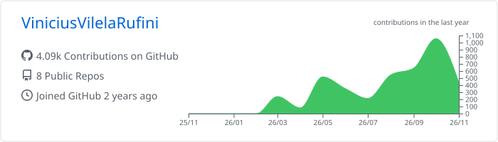
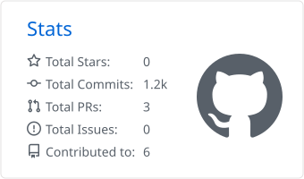
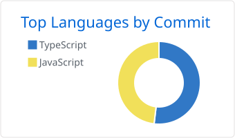

# Vinicius Vilela Rufini

**Desenvolvedor Full Stack · Web & Mobile · IA aplicada a produtos**

Transformo ideias em produtos digitais completos — da modelagem de dados e APIs no backend
até interfaces fluidas em Web e Mobile. Código limpo, escalável e orientado a resultado.

 

 

## Sobre mim

- Atuo **end-to-end**: arquitetura, backend, frontend, mobile e deploy.
- Interesse em produtos que unem **Inteligência Artificial**, **automação de processos** e **UX**.
- Estudante de **Ciência da Computação** na UNIP.

 

## Stack

  

  

  

 

## Projetos em destaque

| Projeto | Descrição | Stack |
|---|---|---|
| [**Prestare IA**](https://github.com/ViniciusVilelaRufini/Prestare-IA) | Plataforma de gestão condominial com backend escalável e frontend multiplataforma. | NestJS · Prisma · Flutter · Render · Vercel |
| [**Kabania**](https://github.com/ViniciusVilelaRufini/kabania) | Gestão com IA sobre o conceito de **Kanban Cognitivo de Ciclo Fechado** — fluxo visual + decisão orientada por dados. | JavaScript · IA |
| [**Volti**](https://github.com/ViniciusVilelaRufini/Aluguel-moto) | App de aluguel de motos elétricas. | TypeScript |
| [**Trading IA**](https://github.com/ViniciusVilelaRufini/Trading-ia) | Experimentos com IA aplicada a análise de mercado. | JavaScript |

 

## Estatísticas

<picture>
  <source media="(prefers-color-scheme: dark)" srcset="https://raw.githubusercontent.com/ViniciusVilelaRufini/ViniciusVilelaRufini/main/profile-summary-card-output/github_dark/0-profile-details.svg"/>
  
</picture>

<picture>
  <source media="(prefers-color-scheme: dark)" srcset="https://raw.githubusercontent.com/ViniciusVilelaRufini/ViniciusVilelaRufini/main/profile-summary-card-output/github_dark/3-stats.svg"/>
  
</picture>
<picture>
  <source media="(prefers-color-scheme: dark)" srcset="https://raw.githubusercontent.com/ViniciusVilelaRufini/ViniciusVilelaRufini/main/profile-summary-card-output/github_dark/2-most-commit-language.svg"/>
  
</picture>

<picture>
  <source media="(prefers-color-scheme: dark)" srcset="https://streak-stats.demolab.com/?user=ViniciusVilelaRufini&theme=dark&hide_border=true&background=00000000&date_format=j%20M%5B%20Y%5D"/>
  
</picture>

  

<picture>
  <source media="(prefers-color-scheme: dark)" srcset="https://raw.githubusercontent.com/ViniciusVilelaRufini/ViniciusVilelaRufini/output/github-snake-dark.svg"/>
  
</picture>

 

## Contato

 

<i>Construindo soluções ponta a ponta, uma linha de código por vez.</i>

